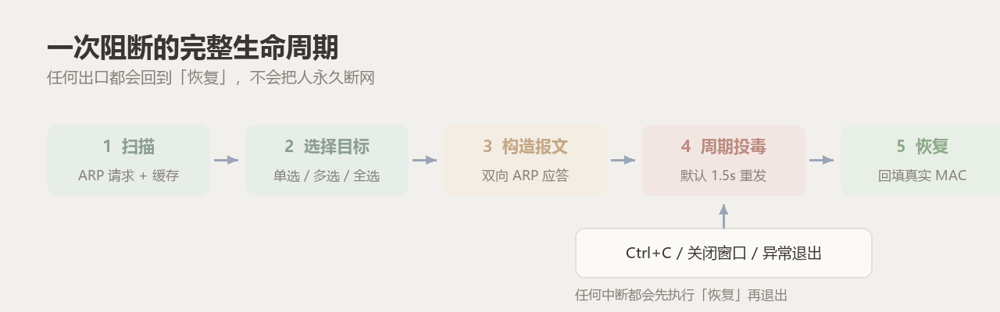
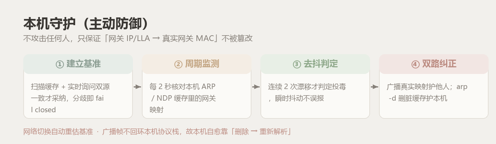

# WiFiKill

<div align="center">


**局域网设备发现 · ARP/NDP 定向阻断 · 逐台占空比限速 · 阻断效果验证 · 本机守护 · 全网哨兵**

纯标准库 + scapy，零第三方 UI 库；单文件免安装，不依赖手机 ROOT。

</div>

---

## ⚠️ 免责声明（先读这一段）

> **本工具仅用于你拥有、或已获得书面授权的网络的学习、研究与安全测试，以及教学演示。**
>
> - 未经授权干扰他人网络通信，可能违反《中华人民共和国网络安全法》第二十七条、
>   《中华人民共和国治安管理处罚法》第二十九条；情节严重可触犯《中华人民共和国刑法》
>   第二百八十五条、第二百八十六条。
> - 请勿对不属于你的网络、设备或个人使用本软件。
> - 本软件按「现状」提供，不附带任何明示或暗示的担保；因使用造成的网络中断、设备失联、
>   数据丢失或其他后果由使用者自行承担，**作者不对任何滥用行为承担责任**。
> - 安装向导首屏展示同一份声明并要求勾选同意；三份文档（README / 用户手册 / 技术手册）均重复该声明。
>
> 如果你不确定某个网络是否「属于你」，那它就不属于你。

---

## 目录

- [这是什么](#这是什么) · [它不是什么](#它不是什么) · [30 秒开始](#30-秒开始)
- [功能一览](#功能一览) · [界面](#界面) · [原理](#原理)
- [本机守护](#本机守护主动防御) · [全网哨兵](#全网哨兵) · [占空比限速](#占空比限速) · [验证断网](#验证断网)
- [架构](#架构) · [安全设计](#安全设计) · [安装](#安装)
- [用法与使用说明](#用法与使用说明) · [20 个使用实例](#20-个使用实例) · [常见问题](#常见问题)
- [目录结构](#目录结构) · [开发与测试](#开发与测试) · [审查与验证](#审查与验证) · [版本与文档](#版本与文档) · [许可](#许可)

---

## 这是什么

WiFiKill 是一个 Windows 桌面程序：把同一局域网里的设备列出来，并对选中的设备做**定向 ARP（IPv4）
/ NDP（IPv6）双向投毒阻断**——目标保持 Wi-Fi「已连接」，但打不开网页。

它同时把「怎么才算真断了」做成了可验证的动作：一键**验证断网**，逐台告诉你投毒是否真的生效。

还自带两套防御与观察能力：**本机守护（Guard）**持续纠正被篡改的网关映射；**全网哨兵（Sentinel）**
维护设备基线、新设备上线告警、投毒时尝试指认攻击者。

## 它不是什么

| 你以为的 | 实际的 |
|---|---|
| 破解 Wi-Fi 密码 | 完全不碰密码与握手，只在**已连上**的局域网里工作 |
| 需要手机 ROOT / 装东西到别人设备 | 只在你这台 Windows 上运行，目标设备零配合 |
| 真限速（像路由器限带宽） | ARP 层做不到真限速，本程序做的是**占空比节流**（可自定义百分比） |
| 能断 IPv6 直连（投屏/AirDrop/局域网互传） | 只能断**经默认网关的出站**，同链路直连不受影响 |
| 验证断网=证明对方彻底没网 | 只证明**投毒生效**（帧被打到本机）；对方有 IPv6 直连或蜂窝网络时仍能上网 |
| 装完就能用 | 需要先装 **Npcap**（发包必需），权限不足时只能扫描 |

## 30 秒开始

1. **装驱动**：下载安装 [Npcap](https://npcap.com/#download)，安装时**务必勾选**
   `WinPcap API-compatible Mode`（发送二层帧的前提）。
2. **下载运行**：从 [Releases](https://github.com/Asaceoo/WiFi-Kill/releases) 取
   `WiFiKill-vX.Y.Z.exe`（单文件版），放到**可写目录**（不要放 `C:\Program Files`），双击运行。
3. **扫描 → 阻断**：等自动扫描完成 → 选中目标行 → 点「阻断选中」；状态列变红「阻断中」即生效。
4. **验证**：点「验证断网」确认投毒真的生效（逐台判定，见[下文](#验证断网)）。

> 撤销：右键「放行选中」或「全部放行」。关闭窗口只是缩到托盘（阻断继续生效），
> 要彻底退出请走托盘右键 →「退出」。

---

## 功能一览

| 功能 | 说明 | 状态 |
|---|---|---|
| 🔍 设备发现 | 主动 ARP 扫描 + 系统缓存合并，显示 IP / MAC / 厂商 / 类型 / 标识 | 稳定 |
| 🚫 定向阻断 | 对选中设备做 ARP 双向投毒（同时骗目标与网关），支持多选批量 | 稳定 |
| ⛔ 全阻断 | 阻断除网关、本机、白名单外的全部设备；检测到双栈时问是否一并切断 IPv6 | 稳定 |
| ✅ 全部放行 | 回填真实映射，秒级恢复（IPv4 与 IPv6 阻断都算） | 稳定 |
| 🐢 占空比限速 | 右键四档预设（80/50/20%）+ **自定义 10–100% 任意百分比**，逐台或批量 | 稳定 |
| 🔎 验证断网 | 逐目标被动嗅探：出站帧被打到本机=已生效、仍走真实网关=未生效；限速目标单独判定 | 稳定 |
| 🛡️ 本机守护 | 核对并纠正网关真实映射，抵御 ARP/NDP 投毒；双源 fail closed | 稳定 |
| 🗡️ 全网哨兵 | 设备基线库、新设备上线告警、投毒者指认（标注「疑似」）、事件流留痕 | 稳定 |
| 🔗 IPv6 定向阻断 | 对**多个目标并发**做 NDP 投毒，只断经网关的出站（实验，默认关，全阻断可临时启用） | 实验 |
| 🪪 管理员重启 | 设置里一键 UAC 提权重启（先恢复阻断再重启，不会撞单实例锁） | 稳定 |
| 🥷 演练模式 | 只构造并打印报文，不发送、不写状态、不动本机缓存 | 稳定 |
| 💾 崩溃恢复 | 状态原子落盘，强杀/断电后重启询问是否恢复；换网自动忽略旧记录 | 稳定 |
| 🔔 系统托盘 | 关闭窗口缩到托盘，右键可显示/全部放行/退出 | 稳定 |
| ⚙️ 开机自启 | 写 HKCU Run 键并以管理员身份启动（可选） | 稳定 |

## 界面

<p align="center">
  
</p>

| 区域 | 作用 |
|---|---|
| 顶部徽章 | 绿=就绪；黄=缺 Npcap / 依赖 或 IPv6 未覆盖；蓝条=未提权 |
| 网络信息条 | 网卡、本机 IP/MAC、网关 IP/MAC、网段 |
| 按钮组 | 扫描设备 / 全选 / 反选 / 阻断选中 / 全阻断 / 全部放行 / **验证断网** / 守护本机 / 设置 |
| 设备表 | 状态列实时显示「阻断中 / 限速 N% / 白名单 / 网关 / 本机 / 未阻断」，支持多选 |
| 运行日志 | 扫描、阻断、纠正、验证、哨兵事件都带时间戳 |
| 页脚徽章 | 在线 N · 阻断 M · IPv6 状态 · 守护中 |

## 原理

<p align="center">
  
</p>

ARP 协议没有认证：任何设备都能宣称「192.168.1.1 的 MAC 是我」。本程序把这个特性用在**双向**上——

```
目标 192.168.1.5  ←  «网关 IP 的 MAC 是我(攻击方)»       目标的出站帧发到攻击方，黑洞
网关 192.168.1.1  ←  «192.168.1.5 的 MAC 是我(攻击方)»   网关的回包也发给攻击方
```

两帧都是**标准 ARP 应答**，不改任何设备、不装代理，所以目标看不到异常（Wi-Fi 仍「已连接」），
只是出不去；恢复时把**真实映射**回填 5 次即可。因为 ARP 在链路层、认证之后，**WPA3 / PMF 也挡不住**。

### 三道失控保护

1. **网关 / 本机永不可阻断**：API 层强制（`core.Killer.add`），IP 或 MAC 任一命中即拒绝；
2. **IPv6 只发单播 NA**：`NdpBlocker._send()` 拒绝一切组播/广播目的地址；
3. **IPv6 运行中自检**：每 5 拍核对本机网关映射，被自己改坏立即停手并回填。

## 本机守护（主动防御）

<p align="center">
  
</p>

阻断是**攻击**别人，守护是**保护**自己：持续保证「本机缓存里，网关 IP/LLA 指向真实网关 MAC」。

- 只发「网关真实映射」这一条真实信息，绝不伪造第三方；
- L2 源用本机 MAC（不冒充网关）；基准必须「缓存 + 实时询问」双源一致，分歧/不可达 **fail closed**；
- **本机缓存自愈**：广播帧不回环本机栈，漂移时 `arp -d` 删脏条目由真实网关重建；
- IPv6 重宣告一律**单播到本机**；换 Wi-Fi 后自动重估基准。

## 全网哨兵

- **基线库**：首次扫描静默入册；之后新 MAC 出现立即弹通知，人工认领/移出；
- **投毒者指认**：漂移后短嗅探，给出攻击者以太网源 MAC，结论标注**「疑似（MAC 可伪造，供参考）」**；
- **事件流**：新设备/认领/移出/投毒留痕（最近 200 条，落盘 `sentinel.json`），设置 →「哨兵事件…」可查；
- **通知去重**：同一事件 5 分钟只弹一次。

## 占空比限速

ARP 层做不了真限速。本程序的诚实做法是**占空比节流**：10 拍一轮，按比例交替发投毒帧（断）与
恢复帧（通）。右键「限速（自定义 %）…」可用滑杆调 **10–100%** 任意值，对选中（未选则全部）
已阻断设备生效；预设 80 / 50 / 20% 保留。duty=50 就是约一半时间能上网，体感「一直卡」而非被踢。

## 验证断网

点「验证断网」（或右键「验证是否已断网」），程序对每台已阻断设备做 4 秒**被动嗅探**：

| 判定 | 含义 |
|---|---|
| 已生效 | 目标的出站帧正被打到本机（它上不了网） |
| 部分生效 | 仍有帧直接发给真实网关（可能在回填缓存，可调小间隔后重验） |
| 未生效 | 目标仍直连真实网关（留意客户端隔离、缓存刷新过快） |
| 限速中（N%） | 该设备在限速，直连网关的帧属于放行拍，**属预期** |
| 无法判定 | 窗口内没抓到该目标的帧（设备空闲），让它产生流量再验 |

> 只观测、不额外发包；判据是「投毒是否生效」，不是「目标彻底没网」。

## 架构

<p align="center">
  
</p>

| 文件 | 职责 |
|---|---|
| `core.py` | 逻辑层：发现 / 报文构造 / 阻断会话（含限速）/ 状态持久化 / 单实例锁 / 白名单 / 安全不变量 / 守护 `Guard` / 哨兵 `Sentinel` / 验证 `verify_targets` |
| `gui.py` | 表现层：Canvas 自绘主窗口、工作线程 + 队列、右键菜单、设置与哨兵面板、托盘接线 |
| `ui.py` | 视觉层：莫兰迪色板、圆角、Canvas 按钮、动效调度 |
| `tray.py` | 托盘：纯 ctypes 调 `Shell_NotifyIcon`，独立线程消息循环 |
| `ipv6.py` | IPv6 层：环境探测、LLA 探明、多目标 NDP 投毒与失控保护 |
| `build.py` | 一键构建：版本自增 → 文档版本同步与**校验** → 三产物 |
| `tests/` | 六套无头测试（205 项）+ GUI 冒烟（CI 可跑） |
| `selftest.py` | 真机 GUI 端到端自检（51 项） |

## 安全设计

<p align="center">
  
</p>

1. **网关/本机保护（API 层）**：目标 IP 或 MAC 任一命中即被拒绝，GUI 与任何调用方都绕不过；
2. **白名单**：单目标与全阻断两条路径都过滤（IP 或 MAC 命中即跳过）；
3. **演练模式**：只打印报文，不发包、不写状态、不动本机 ARP/NDP 缓存；
4. **换网即中止**：阻断会话持有网络快照，扫描发现网卡/网关变化立即停止旧阻断并告警；
5. **单实例**：本地端口互斥；管理员重启时**先释放锁再拉起新实例**，不会撞「已在运行」；
6. **崩溃恢复**：原子写状态；换网络后残留记录自动忽略并清除。

---

## 安装

### 三种形态，按需选一个

| 形态 | 文件 | 适合谁 | 说明 |
|---|---|---|---|
| **安装版** | `WiFiKill-vX.Y.Z-setup.exe` | 想要开始菜单/桌面快捷方式 | 中文向导，**首屏免责声明需勾选同意**，装完可选打开 Npcap 下载页 |
| **单文件版** | `WiFiKill-vX.Y.Z.exe` | 拷走即用、U 盘携带 | 绿色单文件，双击运行（放可写目录） |
| **打包版** | `WiFiKill-vX.Y.Z-portable.zip` | 连文档一起带走 | exe + README + 两份手册 + 概念图 + 许可 |

### 通用步骤

1. **装 Npcap**（必需）：[下载页](https://npcap.com/#download)，安装时勾选 `WinPcap API-compatible Mode`；
2. **放对位置**：单文件版/打包版放可写目录，不要放 `C:\Program Files`（程序要在旁边写状态文件）；
3. **首次启动**：单文件 exe 自解包约 2–3 秒；顶部绿点「就绪」即成功；
4. **权限**：多数网卡普通用户可发帧；被拒绝时点设置里的「以管理员身份重启」。

### 从源码运行（开发者）

```bash
python -m venv .buildenv
.buildenv\Scripts\pip install scapy pyinstaller
python gui.py
```

要求 Python 3.10+（构建/CI 用 3.12），解释器需自带 tkinter。

---

## 用法与使用说明

### 界面元素

| 区域 | 说明 |
|---|---|
| 顶部徽章 | 🟢 就绪 / 🟡 未装 Npcap、依赖缺失、IPv6 未覆盖 / 🔵 未提权 |
| 网络信息条 | 网卡 · 本机 IP/MAC · 网关 IP/MAC · 网段 |
| 扫描设备 | 重扫局域网（主动 ARP + 系统缓存合并），扫描期间禁用 |
| 全选 / 反选 | 选中全部可见行 / 反选当前所选 |
| 阻断选中 | 对选中行做 ARP（+可选 NDP）双向投毒，支持批量 |
| 全阻断 | 阻断除网关、本机、白名单外的全部设备；双栈时会问是否连 IPv6 一起断 |
| 全部放行 | 回填真实映射恢复全部（IPv4 与 IPv6 都算） |
| 验证断网 | 逐台判断投毒是否真的生效（被动嗅探，不发新包） |
| 守护本机 | 切换本机主动防御；开启后显示「守护中」 |
| 设置 | 重发间隔 / 演练模式 / IPv6 阻断 / 守护 / 开机自启 / 哨兵事件 / 以管理员身份重启 |

### 设备表状态列

| 状态 | 含义 |
|---|---|
| 网关 / 本机 | 受保护，永不被阻断 |
| 白名单 | 被保护，阻断时自动跳过 |
| 阻断中 | 正在双向投毒（双栈全断显示「阻断中·双栈」，只断 IPv4 显示「阻断中·仅v4」） |
| 限速 N% | 已阻断但按占空比节流，N% 的时间可上网 |
| 未阻断 | 正常 |

### 右键菜单

| 菜单项 | 作用 |
|---|---|
| 阻断选中 / 放行选中 | 对选中行执行阻断或恢复 |
| 限速（自定义 %）… | 滑杆调 10–100%，对选中（未选则全部）已阻断设备生效 |
| 限速 80% / 50% / 20% | 预设档位，断断通通 |
| 取消限速（恢复全断） | 回到持续投毒 |
| 验证是否已断网 | 对已阻断设备做一次被动嗅探判定 |
| 加入白名单 / 移出白名单 | 白名单设备不再被全阻断扫到 |
| 设置备注… / 清除备注 | 给设备起名（按 MAC 保存），显示在「标识」列 |
| 复制 IP / 复制 MAC | 粘到路由器后台做绑定/拉黑 |

### 常用操作

**阻断一台设备**：选中该行 → 「阻断选中」→ 状态列变红。目标仍显示 Wi-Fi 已连接，但打不开网页。

**恢复**：右键「放行选中」或「全部放行」（恢复帧连发 5 次抵消丢包）。

**限速而不是全断**：先阻断 → 右键「限速（自定义 %）…」或预设档 → 状态列显示「限速 50%」。

**全阻断（含 IPv6）**：点「全阻断」→ 弹窗显示**过滤后**台数；若本网有 IPv6，会问是否一并切断出站，
选择后本次生效（不改持久设置）。

**白名单**：右键「加入白名单」→ 状态列变紫；同时记录 IP 与 MAC。

**守护本机**：点「守护本机」→ 页脚出现「守护中」；检测到投毒并纠正后显示「守护中·纠正 N」。

**哨兵**：设置 →「哨兵事件…」：待认领列表（可多选认领/移出/全部认领）+ 事件历史。

**演练模式**：设置里勾选后所有报文只打印不发送，也不写状态文件、不动本机缓存。

**崩溃恢复**：强杀/断电后重启会问「上次还有 N 台处于阻断，现在恢复吗？」；换网后自动忽略旧记录。

**托盘**：点窗口 × 只是缩到托盘（阻断继续生效）。

**以管理员身份重启**：设置窗口左下角，一键 UAC 提权；会先恢复阻断再重启。

### 设置项

| 设置项 | 默认 | 说明 |
|---|---|---|
| 重发间隔 | 1.5 秒 | 0.5–10 秒；目标恢复快就调小 |
| 演练模式 | 关 | 只构造报文不发送（守护同样受控） |
| 启用 IPv6 阻断（实验） | 关 | 不记住上次开关；全阻断时也可临时开启 |
| 守护本机（主动防御） | 关 | 状态持久化（`guard.json`） |
| 开机自动启动（管理员） | 关 | HKCU Run 键 + UAC 清单 |
| 哨兵事件…（按钮） | — | 打开哨兵面板 |
| 以管理员身份重启（按钮） | — | 仅非管理员时出现 |

---

## 20 个使用实例

> 全部假设你在**自己有权管理**的网络内操作。

| # | 场景 | 操作 | 结果 |
|---|---|---|---|
| 1 | 宿舍有人 24 小时挂机下载，全楼卡顿 | 扫描 → 找到那台 → 阻断后右键「限速 50%」 | 它卡到怀疑人生但没被踢 |
| 2 | 只想教训一下、不想彻底断 | 右键「限速（自定义 %）…」调到 20% | 大部分时间上不了网，仍能收消息 |
| 3 | 想知道家里连了多少设备 | 打开程序等扫描完成 | 页脚显示「在线 N」 |
| 4 | 发现陌生设备在蹭网 | 记 MAC → 阻断 → 去路由器拉黑 | 先止血，再彻底解决 |
| 5 | 担心有人在网内搞 ARP 投毒 | 点「守护本机」 | 缓存被篡改自动纠正，页脚「守护中·纠正 N」 |
| 6 | 想知道阻断到底生效没有 | 点「验证断网」 | 逐台给出已生效/未生效/无法判定 |
| 7 | 验证路由器是否开了客户端隔离 | 扫描看能否看到其他设备 | 只看到网关=开了隔离 |
| 8 | 想确认某个 IP 对应哪台设备 | 右键设置备注 + 看厂商列 | 定位到具体设备 |
| 9 | 让孩子晚上 21:30 后不能上网 | 全阻断 → 次日早上全部放行 | 比改路由器简单 |
| 10 | 测试智能音箱断网后会不会重连 | 阻断 30 秒 → 放行 → 看 App 状态 | 验证设备健壮性 |
| 11 | 验证自己 App 的离线模式 | 阻断开发机 → 断网测试 | 排除「其实还在偷偷请求」 |
| 12 | 演示 ARP 欺骗的危害（教学） | 演练模式 → 讲报文 → 真机演示 10 秒 | 学生直观看到「连着但没网」 |
| 13 | 证明 WPA3 挡不住 ARP 攻击 | 在 WPA3 网络里阻断一台设备 | 仍然有效（ARP 在认证之后） |
| 14 | 断开全家 IPv6-only 设备的出站 | 全阻断 → 弹窗选「同时切断 IPv6」 | 多目标并发 NDP 投毒，页脚「IPv6 已接管」 |
| 15 | 临时冻结设备联网做取证 | 阻断 → 操作 → 放行 | 期间无法上传/回传 |
| 16 | 怀疑网关 MAC 被冒充 | 看网络信息条网关 MAC，与路由器标签比对 | 开守护后不一致会被纠正并告警 |
| 17 | 双栈网络阻断后还能上网 | 看页脚「IPv6 未覆盖」→ 重做全阻断并选 IPv6 | 不再静默失效 |
| 18 | 验证全阻断的过滤逻辑 | 演练模式 → 全阻断 → 看日志跳过了谁 | 网关/本机/白名单都被跳过 |
| 19 | 出门前确保 IoT 不跑流量 | 全阻断 → 关窗口保留 → 回来放行 | 状态跨进程保持 |
| 20 | 普通用户发不出帧 | 设置 →「以管理员身份重启」 | 提权后继续用，阻断不丢 |

---

## 常见问题

**Q：装完 Npcap 还提示未检测到？** 确认勾了 `WinPcap API-compatible Mode`，装完重启一次。

**Q：扫描只看到网关和自己？** 网络开了客户端隔离（AP Isolation），任何工具都绕不过。

**Q：阻断后对方几秒就恢复？** 把重发间隔调小（0.5–1 秒），或对方缓存刷新策略激进。

**Q：验证显示「未生效」？** 检查客户端隔离、把间隔调小后重验；目标可能有 IPv6 直连。

**Q：验证显示「无法判定」？** 目标在 4 秒窗口内没发帧，让它产生流量再验。

**Q：限速设备验证总是「限速中」？** 这是预期：放行拍的帧会直连真实网关，判定已按限速单独解释。

**Q：点阻断没反应？** 目标可能被过滤（网关/本机/白名单），看状态列颜色。

**Q：关闭窗口后设备还断着？** 缩到托盘继续生效，托盘右键「全部放行」或「退出」。

**Q：杀软报毒？** PyInstaller 单文件 + 网络扫描是常见误报；源码在仓库，可自行核对。

**Q：支持 Linux / macOS？** 仅 Windows 10/11。

---

## 目录结构

```
WiFi-Kill/
├── core.py               逻辑层：发现 / 投毒 / 限速 / 状态 / 守护 / 哨兵 / 验证
├── gui.py                表现层：主窗口、右键菜单、设置、哨兵面板
├── ui.py                 视觉层：色板、圆角、按钮动画、波纹、光晕
├── ipv6.py               IPv6 层：探测 / 探明 / NDP 投毒
├── tray.py               系统托盘（纯 ctypes）
├── build.py              构建 + 版本自增 + 文档版本同步与校验
├── versions.json         版本真源
├── selftest.py           真机 GUI 自检（51 项）
├── tests/                六套无头测试（205 项，含 GUI 冒烟 26 项）
├── tools/                图标与概念图生成
├── installer/            Inno Setup 脚本 + 中文语言 + 免责声明
├── docs/                 用户手册 / 技术手册 / images 概念图
├── .github/workflows/    推 tag：校验版本 → 跑测试 → 构建 → 发布
├── CHANGELOG.md          更新日志
└── LICENSE.txt
```

## 开发与测试

```bash
python tests/test_edge.py        # 边界与故障路径 75 项
python tests/test_ipv6.py        # IPv6 报文级 65 项
python tests/test_guard.py       # 本机守护 21 项
python tests/test_sentinel.py    # 全网哨兵 12 项
python tests/test_throttle.py    # 占空比限速 6 项
python tests/test_gui_smoke.py   # GUI 冒烟 26 项（不发包，CI 也跑）
python selftest.py               # 真机端到端 51 项（驱动真实窗口）
python build.py --bump patch     # 版本自增 + 文档同步与校验 + 三产物
```

发布：`python build.py --bump patch` → 提交（含 `versions.json` 与文档）→ `git tag vX.Y.Z` →
`git push origin main --tags`。CI 先校验 tag 与 `versions.json` 一致，再跑全部无头测试、构建
**单文件版 / 安装版 / 打包版**并发布 Release（附 README 与两份手册）。

## 审查与验证

项目按「工具实现者 / 审查者 / AI 使用方」三视角做了多轮对抗性审查：每条缺陷先写成可复现探针看到红，
再改代码到绿，最后把等价断言固化进测试。

| 层 | 规模 | 说明 |
|---|---|---|
| 无头测试 | **205 项** | 边界 75 + IPv6 65 + 守护 21 + 哨兵 12 + 限速 6 + GUI 冒烟 26 |
| 真机自检 | **51 项** | 真实窗口 + 扫描 + 幽灵设备端到端（限速/守护/哨兵/换网中止） |
| 清单兜底 | 17 项 | 编译、红线、安全不变量、dry-run 纯净、版本一致、文档计数与实跑一致 |

## 版本与文档

| 项目 | 当前版本 | 说明 |
|---|---|---|
| 程序 | **v2.7.3** | 见 [Releases](https://github.com/Asaceoo/WiFi-Kill/releases) |
| [用户手册](docs/USER_MANUAL.md) | v1.7.3 | 面向使用者，含教程 A–P 与故障排查 |
| [技术手册](docs/TECH_MANUAL.md) | v1.7.3 | 面向开发者，含报文/线程/状态机/测试/发布 |
| [更新日志](CHANGELOG.md) | — | 每个版本改了什么 |

版本号由 `build.py` 语义化递增，程序与两份手册在构建时自动同步并**校验**（不一致即中止构建），
`versions.json` 是唯一真源。

## 许可

本仓库仅供学习与研究。**不提供任何明示或暗示的授权用于非自有网络。**

---

## ⚠️ 免责声明（再次重申）

本软件仅用于**自有网络或已获书面授权**的安全测试、教学演示与研究。
未经授权干扰他人网络通信可能违反《网络安全法》第二十七条、《治安管理处罚法》第二十九条；
情节严重可触犯《刑法》第二百八十五条、第二百八十六条。
**作者不对任何滥用行为承担责任。** 如果你不确定某个网络是否属于你，那它就不属于你。
