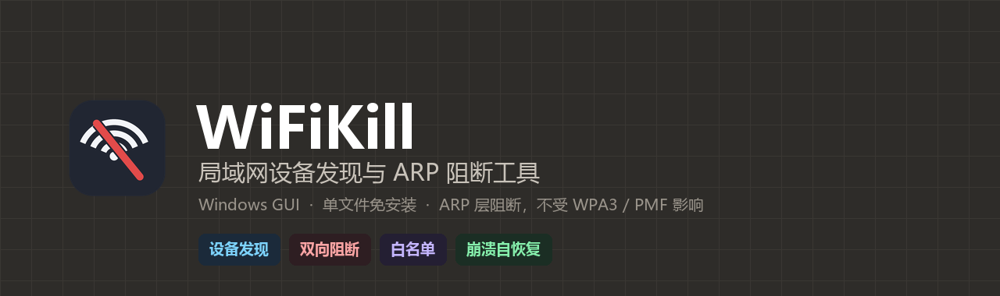
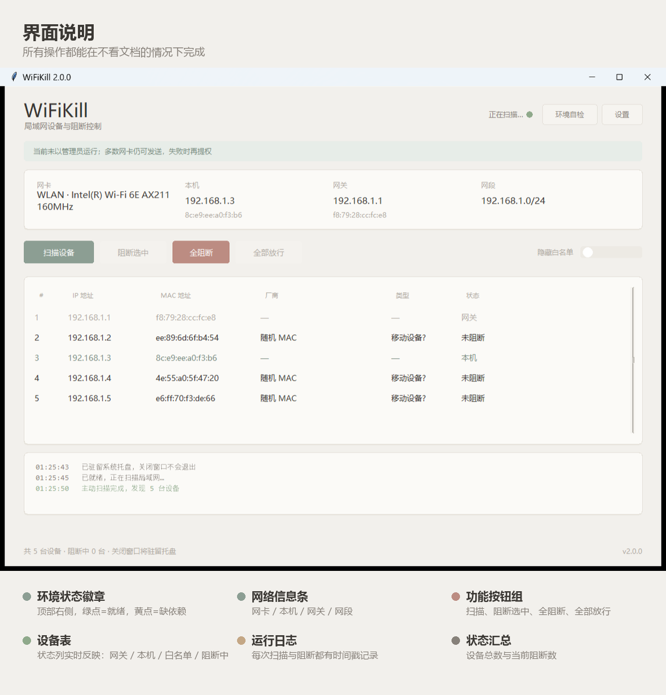
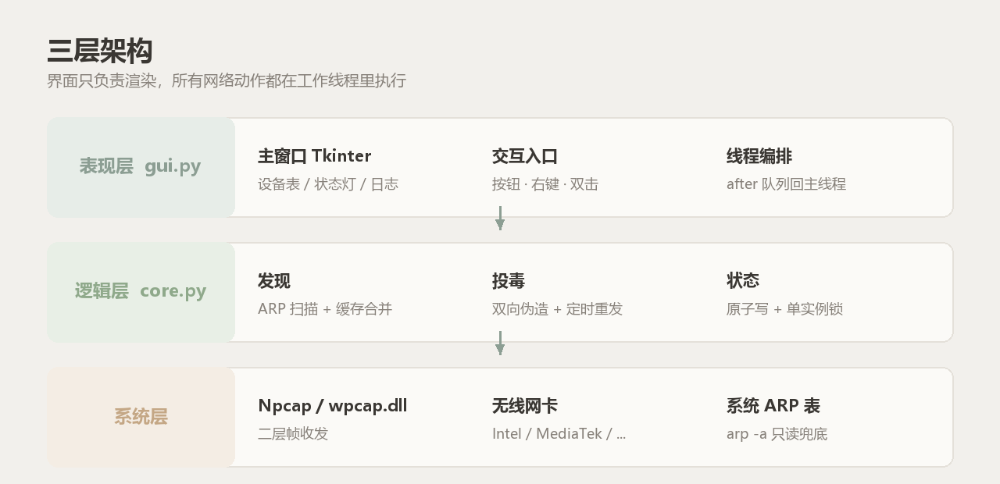
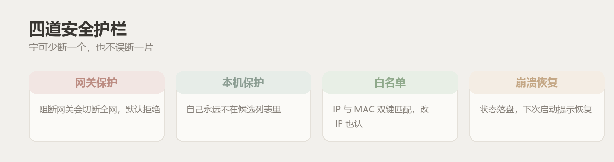

<div align="center">



# WiFiKill

**局域网设备发现与 ARP 阻断工具**
Windows GUI · 单文件免安装 · 不依赖手机 ROOT · 莫兰迪自绘界面


</div>

---

## ⚠️ 免责声明

> **本工具仅用于自有网络，或已获得书面授权的网络的安全测试与教学演示。**
>
> 未经授权对他人网络实施 ARP 欺骗、阻断他人网络通信，在中国大陆可能违反
> 《中华人民共和国网络安全法》第二十七条、《治安管理处罚法》第二十九条，
> 情节严重可触犯《刑法》第二百八十五条、第二百八十六条。
> 其他国家/地区同样有对应的计算机犯罪条款（如美国 CFAA §1030、英国 CMA 1990 s.3）。
>
> **作者不对任何滥用行为承担责任。下载、运行即表示你已理解并接受上述风险。**
>
> 如果你不确定某个网络是否"属于你"，那它就不属于你。

---

## 这是什么

WiFiKill 是一个 Windows 桌面程序，能列出同一局域网里的所有设备，并对选中的设备
实施 **ARP 双向投毒**——让它显示"已连接 WiFi"，但实际上收发不了任何数据。

它解决的问题很具体：**手机上的 WiFi 杀手类 App 几乎全部需要 ROOT，而现在的手机基本
不可能 ROOT。** WiFiKill 把同样的能力搬到电脑上，不需要动手机。

## 它不是什么

| 常见误解 | 事实 |
|---|---|
| 能破解 WiFi 密码 | ❌ 不能，也不打算做 |
| 能免密码连上别人的 WiFi | ❌ 不能，前提是你已经在网内 |
| 需要 root / 越狱 | ❌ 不需要，Windows 上普通用户即可运行 |
| 对所有网络都有效 | ❌ 开了客户端隔离（AP Isolation）的网络拿不到目标 |
| 是 802.11 去认证 | ❌ 不是。走的是 ARP 层，因此 **不受 WPA3 / 802.11w(PMF) 影响** |

---

## 功能一览

| 能力 | 说明 |
|---|---|
| 🔍 设备发现 | ARP 主动扫描 + 系统 ARP 缓存合并，避免漏掉休眠设备 |
| 🏷️ 厂商识别 | 内置 OUI 表，识别 Apple / 小米 / 华为 / 三星 / Espressif 等 |
| 🏷️ 设备备注 | 右键给设备起名（"小明的手机"），跨重启保留，显示在「标识」列 |
| 🚫 单设备阻断 | 选中一台，双向投毒，目标立刻失去外网 |
| 🚫 全阻断 | 一键阻断除网关、本机、白名单外的所有设备 |
| ✅ 全部放行 | 回填真实 MAC，秒级恢复，目标无感知 |
| 📋 白名单 | IP + MAC 双键匹配，设备换 IP 也不会误断 |
| 🛡️ 网关保护 | 阻断网关会切断整个网络，默认直接拒绝 |
| 🔁 崩溃恢复 | 阻断状态实时落盘，进程被杀后下次启动提示恢复 |
| 🧪 演练模式 | 只构造并打印报文，不真正发送，用于验证配置 |
| 🪟 单实例 | 多开会互相覆盖状态，已用本地端口互斥 |
| 📌 系统托盘 | 关闭窗口不退出，托盘右键可唤回主界面、一键全部放行、退出 |
| 🌐 IPv6 探测 | 扫描时读系统 IPv6 路由表，判定本网是否有全局 IPv6 |
| ⚠️ 覆盖度告警 | 本网有 IPv6 时明确提示「当前阻断只对 IPv4 生效」，不假装断开了 |
| 🔗 IPv6 定向阻断 | 实验功能：对单个目标做 NDP 投毒，切断经网关的出站流量 |
| 🎨 自绘界面 | 莫兰迪配色、圆角卡片、10 类动效、多尺寸自绘图标，零第三方 UI 库 |

---

## 界面

<p align="center">
  
</p>

## 工作原理

ARP 是二层协议，负责把 IP 地址翻译成 MAC 地址，本身**没有任何认证机制**。
WiFiKill 做的是同时欺骗两端：

```
对目标说：网关 192.168.1.1 的 MAC 是 <我的 MAC>
对网关说：目标 192.168.1.5 的 MAC 是 <我的 MAC>
```

两端都把包发到本机，而本机**不开转发**，包直接丢弃 → 双向黑洞。
放行时只要把**真实的 MAC 对应关系**再发一遍，两端的 ARP 缓存就恢复了。

投毒需要周期性重发（默认 1.5 秒），因为 ARP 缓存会超时刷新。

## IPv6：为什么光有 ARP 不够

ARP 是纯 IPv4 协议。现在国内宽带普遍下发全局 IPv6（RA + SLAAC），
双栈设备访问双栈网站时会优先选 IPv6（RFC 6724），这些帧直接发给路由器的真实 MAC，
**根本不经过投毒方**：

```
                    IPv4（被投毒）
    目标设备 ──────────────────────► 本机 ──✕ 不转发
        │
        └──────────────────────────► 路由器      ← IPv6 直连，本机看不到也拦不住
```

结果是**静默失效**：界面写着「阻断中」，目标照常上网。v2.1.0 起分两层处理：

| 层级 | 做法 | 默认 |
|---|---|---|
| **诚实告警** | 本网有全局 IPv6 就挂横幅 + 徽章「IPv6 未覆盖」 | 开启 |
| **定向阻断** | 设置里手动打开后，对单个目标做 NDP 投毒（`ipv6.py`） | 关闭 |

### 定向阻断的能力边界（重要）

只断**经默认网关的出站流量**。以下情况它管不了，也不假装管：

- 同一链路的 IPv6 直连：投屏、AirDrop、局域网互传 —— 这些不经过网关
- 目标处于休眠 / 完全静默：拿不到它的链路本地地址，探明失败时状态列显示「阻断中·仅v4」
- 网络开了客户端隔离：连 ARP 都拿不到目标，更谈不上 IPv6

### 三道失控保护

1. **结构性保险** —— 所有 NA 都走同一个发包出口，该出口拒绝任何组播/广播目的 MAC
2. **默认关闭 + 单目标** —— 设置里手动开启，且同时只能阻断 1 台
3. **运行时自检** —— 阻断中每 5 个周期检查本机到网关的映射，异常立即停手并回填

---

## 架构

<p align="center">
  
</p>

| 文件 | 职责 |
|---|---|
| `gui.py` | 表现层。Canvas 自绘主窗口，所有耗时操作走工作线程，结果经队列回主线程 |
| `ui.py` | 视觉层。莫兰迪色板、圆角绘制、Canvas 按钮（hover/press 插值）、波纹、光晕、呼吸灯 |
| `tray.py` | 系统托盘。纯 ctypes 调 `Shell_NotifyIcon`，独立线程跑消息循环，零第三方依赖 |
| `ipv6.py` | IPv6 层。环境探测、链路本地地址探明、定向 NDP 投毒与失控保护 |
| `core.py` | 逻辑层。设备发现、报文构造、阻断会话、状态持久化、单实例锁 |
| `tests/` | 边界与故障路径测试（23 项）+ IPv6 报文级测试（34 项） |
| `selftest.py` | GUI 端到端自检（28 项，会驱动真实界面） |
| `installer/` | Inno Setup 脚本与简体中文语言文件，产出安装版 |
| `build.py` | 一键构建：语义化版本自增 → 文档版本同步 → 打包 → 出三个产物 |

## 安全设计

<p align="center">
  
</p>

1. **网关保护** —— 目标列表里永远剔除网关（**单目标与全阻断两条路径都强制**）；
   确实要断网关必须改代码，GUI 不提供开关。
2. **本机保护** —— 自己的 IP 不进候选，单目标选择时同样强制跳过。
3. **白名单** —— 阻断前逐条校验，IP 或 MAC 命中任一即跳过。
4. **崩溃恢复** —— 每次增删目标都原子写 `.wifikill-state.json`；异常退出后重启会主动询问是否恢复。

---

## 安装

### 三种形态，按需选择一个

到 [Releases](https://github.com/Asaceoo/WiFi-Kill/releases) 下载：

| 文件 | 形态 | 适合 |
|---|---|---|
| `WiFiKill-vX.Y.Z-setup.exe` | **安装版** | 想要开始菜单 / 桌面快捷方式、需要能正常卸载 |
| `WiFiKill-vX.Y.Z.exe` | **单文件版** | 只想拷一个文件走，随插随用 |
| `WiFiKill-vX.Y.Z-portable.zip` | **打包版** | 需要连同用户手册 / 技术手册一起归档、离线分发 |

> 三者功能完全一致，区别只在分发方式。安装版会把程序装到
> `%LocalAppData%\Programs\WiFiKill`，这个目录可写，白名单与阻断状态会落在那里。

### 安装步骤（任一形态通用）

1. 下载上表中任意一个文件
2. 安装版双击安装即可；单文件版 / 打包版**解压到可写目录**（不要放 `C:\Program Files`）
3. 安装 [Npcap](https://npcap.com/#download)，安装时**务必勾选 `WinPcap API-compatible Mode`**
4. 启动 `WiFiKill.exe`

> Npcap 是发二层帧的驱动层，无法打包进 exe，必须单独装一次。

### 从源码运行（开发者）

```bash
git clone https://github.com/Asaceoo/WiFi-Kill.git
cd WiFi-Kill
python -m venv .buildenv
.buildenv\Scripts\pip install scapy pyinstaller
.buildenv\Scripts\python gui.py
```

要求 Python 3.10+（需自带 tkinter）。

---

## 快速开始

```
1. 装 Npcap（勾选 WinPcap 兼容模式）
2. 双击 WiFiKill.exe
3. 等 3 秒，设备列表自动出现
4. 点中一台设备 → 点「阻断选中」
5. 想恢复就点「全部放行」，或直接关窗口（会缩到托盘）
```

## 使用说明

### 界面元素

| 区域 | 作用 |
|---|---|
| 顶部徽章 | 绿点=就绪；黄点=缺 Npcap/依赖 或 IPv6 未覆盖；蓝条=未提权 |
| 网络信息条 | 网卡型号、本机 IP/MAC、网关 IP/MAC、网段 |
| 按钮组 | 扫描设备 / 阻断选中 / 全阻断 / 全部放行 |
| 设备表 | 「标识」列显示设备是谁，状态列实时显示阻断状态 |
| 运行日志 | 每次扫描、阻断、恢复都有时间戳 |
| 页脚徽章 | 在线 N · 阻断 M · IPv6 状态，数值变化会弹跳提醒 |

### 阻断一个设备

1. 在表格里点一行（按住 Ctrl 可多选）
2. 点「阻断选中」
3. 状态列变红显示「阻断中」，行底色缓慢呼吸，日志出现「已阻断 1 台」

### 给设备起名（备注）

1. 右键设备 → 「设置备注…」
2. 输入名字（如"小明的 iPad"）
3. 「标识」列立即显示，重启后仍在（存于 `aliases.json`）

### 全阻断

点「全阻断」→ 弹窗确认台数 → 网关、本机、白名单会被自动跳过。
弹窗里显示的台数**已经是过滤后的数字**，不会把网关算进去。

### 白名单

- 右键设备 →「加入白名单」，该设备之后不会再被全阻断扫到
- 同时记录 IP 和 MAC：设备换 IP 后仍然有效
- 「隐藏白名单」勾选后从列表中隐去，但阻断仍然跳过它

### 设置

右上「设置」可改重发间隔（0.5–10 秒）、演练模式，以及 **IPv6 阻断（实验）**。
IPv6 阻断默认关闭，且只有在本网检测到全局 IPv6 时才能勾选；勾上后同时只能断 1 台。

### 系统托盘

关闭窗口**不会退出**，而是缩到托盘继续后台保持阻断。

| 托盘操作 | 效果 |
|---|---|
| 左键双击图标 | 唤回主界面 |
| 右键 → 显示主界面 | 同上 |
| 右键 → 全部放行 | 不打开窗口直接恢复所有设备 |
| 右键 → 退出 | 真正退出；若有阻断会先问是否恢复 |

### 退出与恢复

| 退出方式 | 行为 |
|---|---|
| 点窗口关闭按钮 | 缩到托盘（程序仍在运行） |
| 托盘菜单「退出」 | 弹窗询问是否恢复，确认后退出 |
| 任务管理器强杀 | 状态已落盘，下次启动自动提示恢复 |
| 断电 / 蓝屏 | 同上，重启后打开程序按提示恢复 |

---

## 20 个使用实例

> 全部假设你在**自己有权管理**的网络内操作。

| # | 场景 | 操作 | 结果 |
|---|---|---|---|
| 1 | 宿舍里有人 24 小时挂机下载，全楼卡顿 | 扫描 → 找到跑满带宽那台 → 阻断选中 | 它掉网，其他人恢复 |
| 2 | 想知道家里到底连了多少设备 | 打开程序等扫描完成 | 页脚徽章显示「在线 N」 |
| 3 | 发现一个不认识的设备在蹭网 | 记下它的 MAC → 阻断 → 去路由器拉黑 | 先止血，再彻底解决 |
| 4 | 判断自家路由器有没有开 ARP 防护 | 阻断自己另一台测试机，看是否生效 | 生效=有 DAI；不生效=防护到位 |
| 5 | 验证路由器是否开了客户端隔离 | 扫描看能否看到除网关外的设备 | 只看到网关=开了隔离 |
| 6 | 想确认某个 IP 对应哪台实体设备 | 右键设置备注 + 看厂商列，去路由器对照 | 定位到具体设备 |
| 7 | 让孩子晚上 21:30 后不能上网 | 21:30 手动全阻断 → 次日早上全部放行 | 比改路由器简单 |
| 8 | 测试智能音箱断网后会不会自动重连 | 阻断 30 秒 → 放行 → 看 App 状态 | 验证设备健壮性 |
| 9 | 验证自己 App 的离线模式是否真的离线 | 阻断开发机 → 断网测试 | 排除"其实还在偷偷请求" |
| 10 | 演示 ARP 欺骗的危害（教学） | 演练模式打开 → 讲解报文 → 真机演示 10 秒 | 学生直观看到"连着但没网" |
| 11 | 证明 WPA3 挡不住 ARP 攻击 | 在 WPA3 网络里阻断一台设备 | 仍然有效——ARP 在认证之后 |
| 12 | 复现"网络时好时坏"的故障 | 阻断疑似故障源 → 观察是否恢复 | 快速二分定位 |
| 13 | 临时冻结某台设备的联网做取证 | 阻断 → 操作 → 放行 | 期间它无法上传/回传 |
| 14 | 检查网关 MAC 是否被伪造 | 看网络信息条里的网关 MAC → 与路由器背面标签比对 | 不一致=可能有人在冒充网关 |
| 15 | 清点哪些是随机 MAC（隐私地址） | 看「标识」列显示「随机 MAC」的行 | 现代手机默认行为 |
| 16 | 想验证全阻断的过滤逻辑对不对 | 开演练模式 → 全阻断 → 看日志里跳过了谁 | 网关/本机/白名单都被跳过 |
| 17 | 出门前确保家里 IoT 设备不跑流量 | 全阻断 → 关闭窗口时选「否」保留 → 回来再放行 | 状态跨进程保持 |
| 18 | 测试新买的 AP 的抗攻击能力 | 对它下面的设备阻断，看是否触发告警 | 有告警=防护到位 |
| 19 | 团队演示时快速恢复全场 | 「全部放行」一键回填真实 MAC | 秒级恢复，无残留 |
| 20 | 程序被误杀后恢复网络 | 重新打开 → 弹窗「发现残留阻断」→ 选「是」 | 自动恢复上次的目标 |

---

## 常见问题

**Q：装完 Npcap 还是提示未检测到？**
A：安装时必须勾选 `WinPcap API-compatible Mode`；装完要**重开程序**（不是重开窗口）。

**Q：阻断成功了，但目标马上又好了？**
A：说明间隔太大或者目标 ARP 缓存刷新快。把设置里的间隔改成 0.5–1 秒。

**Q：扫描出来只有网关和自己？**
A：这个网络开了**客户端隔离**（常见于咖啡馆、酒店、公司访客网）。任何 ARP 工具都无解。

**Q：为什么不需要管理员也能用？**
A：取决于 Npcap 安装时的选项。部分机器普通用户即可发帧；如果你的不行，点顶部蓝条里的「以管理员重启」。

**Q：会不会把自己也断掉？**
A：不会。本机永远不进候选，网关也永远不进。

**Q：被杀毒软件拦截？**
A：PyInstaller 单文件 + 网络扫描是常见误报特征。源码在仓库里，可自行核对后加白名单。

---

## 版本与文档

| 项目 | 当前版本 | 说明 |
|---|---|---|
| 程序 | **v2.3.0** | 见 [Releases](https://github.com/Asaceoo/WiFi-Kill/releases) |
| [用户手册](docs/USER_MANUAL.md) | v1.3.0 | 面向使用者，含完整操作步骤与故障排查 |
| [技术手册](docs/TECH_MANUAL.md) | v1.3.0 | 面向开发者，含报文结构、线程模型、测试与打包 |
| [更新日志](CHANGELOG.md) | — | 每个版本改了什么 |

版本号由 `build.py` 语义化递增（`--bump patch|minor|major`），文档版本随构建同步。

---

## 目录结构

```
WiFi-Kill/
├── core.py               逻辑层：发现 / 投毒 / 状态 / 单实例锁
├── gui.py                表现层：主窗口与交互编排
├── ui.py                 视觉层：色板、圆角、按钮动画、波纹、光晕
├── ipv6.py               IPv6 层：探测 / 探明 / NDP 投毒
├── tray.py               系统托盘（纯 ctypes）
├── build.py              一键构建 + 语义化版本自增
├── versions.json         版本真源
├── selftest.py           GUI 端到端自检（28 项）
├── tests/test_edge.py    边界与故障路径测试（23 项）
├── tests/test_ipv6.py    IPv6 报文级测试（34 项，CI 可跑）
├── tools/
│   ├── make_images.py    概念图生成
│   └── make_icon.py      多尺寸图标生成（16–256px 分级绘制）
├── installer/
│   ├── WiFiKill.iss      Inno Setup 脚本
│   └── ChineseSimplified.isl
├── docs/
│   ├── USER_MANUAL.md
│   ├── TECH_MANUAL.md
│   └── images/
├── .github/workflows/    推 tag 自动构建发布
├── CHANGELOG.md          更新日志
├── WiFiKill.spec         PyInstaller 配置
└── LICENSE.txt
```

## 开发

```bash
# 跑边界测试（不碰真实设备）
python tests/test_edge.py

# 跑 IPv6 报文级测试（不发包，CI 也跑这个）
python tests/test_ipv6.py

# 跑 GUI 自检（会驱动真实窗口，注入一台"幽灵设备"，不影响任何人）
python selftest.py

# 构建 + 语义化版本自增 + 出三个产物
python build.py --bump minor
```

## 许可

本仓库仅供学习与研究。**不提供任何明示或暗示的授权用于非自有网络。**
使用前请阅读文首的免责声明。
